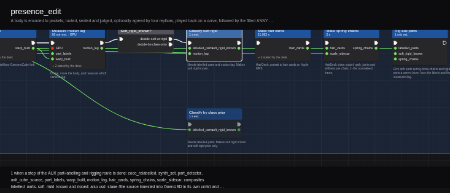

# interactor-plan-lottie

Draws a planner's JSON-LD plan as a Lottie animation in the style of Unreal Engine Blueprints. It is a Lean 4 program: a domain and a plan go in, and a Lottie and a text version of the same graph come out.

## What you see

- White pins and wires are the sequence, the order the planner runs the steps.
- Coloured pins are facts. A step's inputs are on its left (facts it reads) and its outputs on its right (facts it sets).
- A Branch node is a method with two or more alternatives. The way the plan took is lit, and the other is dim.
- Under a node is the action's own `description` from the domain, wrapped to the node's width. The domain marks each one in `description_basis` as written or drafted. The converter draws what the domain says and does not draft anything.
- A step's time shows its milliseconds when it has them: `56 ms`, `3.202 s`, `1 min 7 s`. A step without a stated duration says "not timed".
- A camera follows the node that is running, so part of the graph shows at a time.

## Nothing is drawn that the JSON-LD did not say

The converter may hide what the JSON-LD says, but it may not add to it. The words that are the converter's own are "Sequence", "Then N", "not timed", "GPU" and a count of stated inputs. `plan_lottie_witness` checks this by planting marks: it renders from an empty domain, then from a domain in which every string carries a mark, and fails if a word on screen has neither.

## Use it

You need [Lean 4](https://lean-lang.org/) (the version in `lean-toolchain`, installed by `elan`) and `lake`.

    ./make.sh

builds the converter, draws every plan in `inputs/plans/` into `lottie/`, and runs the checks. To draw your own:

    lake build plan_lottie
    .lake/build/bin/plan_lottie [--grid N] [--transcript out.md] <domain.jsonld> <out.lottie.json> <plan.jsonld>...

One Sequence node runs a part for each plan given. To play a result, serve this folder (`python3 -m http.server`) and open `/viewer.html`, or `/viewer.html?plan=<n>-<name>` for one plan. A `file://` page cannot fetch the JSON. The viewer loads lottie-web from cdnjs, pinned by an integrity hash, and has Pause, Restart and speed controls. It starts paused if the system asks for reduced motion.

## What is here

| Path | What it holds |
| --- | --- |
| `PlanLottie/`, `Main.lean` | the converter |
| `Witness.lean` | the checks (golden, control, invariant and leak), each with a planted fault where it can fail |
| `inputs/domain.jsonld` | the planning domain the plans come from |
| `inputs/plans/` | the plans the planner made from it, named `<n>-<name>.jsonld` |
| `lottie/` | each plan as a Lottie with its text version, and `all`, the plans numbered 0 to 3 together |
| `tests/golden/` | the committed text versions the checks compare against |
| `viewer.html` | the player |
| `make.sh` | build, draw, check |

The domain and the plans are the examples. They describe a character-editing pipeline (presence, a relay, a part-rigging route, an obstacle course, sandbox guests), and the repository does not need that pipeline to run. The domain is a copy: its source is the poseswap domain, so it can drift, and a plan made from a changed domain has to be drawn again.

## Change a plan

Plan again with your planner, put the domain at `inputs/domain.jsonld` and the plan at `inputs/plans/<n>-<name>.jsonld`, and run `./make.sh`. The new plan has no golden yet, so copy `lottie/<n>-<name>.transcript.md` to `tests/golden/` once you have read it and mean it. For a change to an existing plan, copy the new text version over its golden the same way.

## What it does not have

- A check in any player but lottie-web. The text is Arial, so a player without system fonts may letter it differently.
- The measured numbers of the relay and its tick rate. They are not in the domain, so they are not drawn.
- Some times. Only an action with a stated duration shows one.

## Licence

MIT. See [LICENSE](LICENSE). The example plans and domain name third-party tools and models (for example BiRefNet, OmniGen2 and ANNY) only as the names of actions; none of their code or weights is here.
